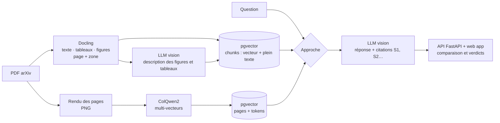

# RAG multimodal sur PDF : Docling, LLM vision et pgvector

On pose une question sur un corpus d'articles scientifiques et on obtient une réponse qui **cite le document et la page**. Le projet compare plusieurs façons de rendre cherchables les tableaux et les figures, puis **mesure** laquelle répond le mieux.

> **État : pipeline complet et testé sur des PDF synthétiques. Les résultats sur le corpus réel restent à mesurer.**
> Aucun chiffre n'apparaît dans ce README tant que l'évaluation n'a pas été exécutée (voir [Résultats](#résultats)).

## Pourquoi

Dans un article, une bonne partie de l'information se trouve dans un tableau de résultats ou dans un graphique, pas dans le texte. Un RAG qui n'indexe que le texte ne peut pas répondre à « quelle précision atteint ce modèle sur la figure 3 ? ». Ce projet met en concurrence quatre approches et sépare trois mesures :

1. **la recherche** : la bonne page est-elle retrouvée (hit@k) ?
2. **la preuve** : la bonne page fait-elle partie de ce qui est envoyé au modèle ?
3. **la réponse** : la valeur attendue est-elle dans la réponse, et la page citée est-elle la bonne ?

## Architecture



| Approche | Ce qui est cherché | Ce que lit le LLM vision |
|---|---|---|
| `text` | texte Docling et tableaux en Markdown, recherche hybride (vecteur + plein texte, fusion RRF) | du texte |
| `captions` | idem, plus les descriptions des figures et tableaux écrites par le LLM vision | du texte |
| `pages` | pages en images, ColQwen2, score MaxSim calculé **dans PostgreSQL** | les images des pages |
| `hybrid` | `captions` et `pages` fusionnés par RRF | texte et images |
| `oracle` | *(évaluation seulement)* les pages de référence, sans recherche | les images des pages |

L'approche `oracle` sert de contrôle : si le modèle se trompe même avec la bonne page sous les yeux, l'erreur vient de la lecture et non de la recherche.

**Interaction tardive dans pgvector.** pgvector stocke un vecteur par ligne, alors que ColQwen2 en produit plusieurs centaines par page. Chaque page a donc une ligne par token dans `page_tokens`, plus un vecteur moyen (index HNSW) qui pré-sélectionne les pages candidates. Le MaxSim (pour chaque token de la question, le meilleur produit scalaire sur la page, puis la somme) est ensuite calculé en SQL sur ces candidates. Avec `MMRAG_PAGE_PREFILTER=0`, le calcul est exact sur toutes les pages.

**Citations vérifiées.** Chaque preuve est numérotée `[S1]`, `[S2]`… Les citations du modèle sont confrontées aux preuves réellement fournies : une citation inventée est signalée, et une réponse sans citation aussi.

## Stack

Python · Docling · PostgreSQL 17 + pgvector · sentence-transformers (BGE-small) · ColQwen2 (colpali-engine) · LLM vision par API compatible OpenAI (Ollama, vLLM, OpenRouter…) · FastAPI · Docker · pytest + GitHub Actions.

## Démarrage

```bash
cp .env.example .env
docker compose up -d db                 # PostgreSQL + pgvector
pip install -e ".[ingest,pages,dev]"
ollama pull qwen2.5vl:7b                # ou un autre LLM vision, voir .env

mmrag download                          # 16 articles arXiv (data/sources.csv)
mmrag parse                             # Docling + rendu des pages
mmrag embed-pages                       # ColQwen2 : lent sans GPU, voir ci-dessous
mmrag describe                          # descriptions des figures et tableaux
mmrag index                             # tout dans pgvector
mmrag serve                             # http://127.0.0.1:8000
```

**Sans GPU :** exécute `notebooks/colab_gpu.ipynb` sur Colab (T4). Il fait le téléchargement, l'extraction et les embeddings de pages, puis zippe `data/`. Dézippe l'archive dans le projet et lance `mmrag index` : les embeddings en cache sont réutilisés.

À noter : pour l'approche `pages`, la question doit aussi être encodée par ColQwen2, qui demande environ 10 Go de RAM sur CPU. Pour tester d'abord sans ce modèle, compare seulement `text` et `captions`.

Avec Docker : `docker compose --profile app up --build`. L'API se branche sur l'Ollama de la machine hôte.

## Évaluation

Le jeu de questions vit dans `evals/questions.jsonl`, une question par ligne (exemple de format, page à vérifier) :

```json
{"id": "t01", "question": "What BLEU score does the big Transformer reach on WMT 2014 English-to-German?",
 "doc_id": "transformer", "pages": [8], "modality": "table", "answer": "28.4 BLEU",
 "match": {"type": "number", "values": [28.4]}, "verified": true}
```

- `evals/questions.draft.jsonl` contient 16 questions de départ. **Aucune n'est vérifiée** : pour chacune, ouvre le PDF, confirme la réponse, renseigne `pages`, puis passe `verified` à `true`.
- Pour mesurer le multimodal, ajoute au moins 5 questions dont la réponse **n'existe que dans une figure** (`"modality": "figure"`).
- `mmrag eval` refuse les questions non vérifiées. `--allow-unverified` permet un essai, mais ses résultats ne doivent pas être publiés.

```bash
mmrag eval                     # toutes les approches + oracle
mmrag judgments                # verdicts humains saisis dans la web app
```

Chaque exécution écrit `evals/results/eval-<date>.json` (le détail par question, la configuration et l'empreinte du jeu de questions) et un résumé `.md` par approche et par type de question.

## Résultats

*À compléter avec la sortie de `mmrag eval` sur le corpus réel.*

## Tests

```bash
pytest -q
```

Les tests couvrent la conversion des documents Docling, le découpage page par page, la fusion RRF, la validation des citations, les métriques, ainsi qu'un parcours de bout en bout sur des PDF synthétiques avec un vrai PostgreSQL + pgvector (MaxSim SQL, les quatre approches, l'évaluation et l'API). Pour les tests, les modèles sont remplacés par des versions factices : ils vérifient le câblage, pas la qualité des réponses. La CI GitHub Actions les exécute à chaque push.

## Limites connues

- Les descriptions de figures générées par le LLM vision peuvent contenir des erreurs de lecture. Elles sont indexées sans relecture humaine.
- La vérification automatique des réponses repose sur la présence des nombres ou mots-clés attendus. Elle est complétée par les verdicts humains de la web app.
- Les questions qui croisent plusieurs articles ne sont pas décomposées en sous-recherches.
- Le corpus est en anglais, et les embeddings texte (BGE-small-en) aussi.

## Crédits

L'idée de séparer recherche, preuve et réponse dans l'évaluation, et de garder la page et la zone de chaque élément extrait, s'inspire de la discussion autour de [multimodal-rag-showcase](https://github.com/miguelCyclone/multimodal-rag-showcase) sur r/Rag. Aucun code n'en est repris. Les PDF ne sont pas redistribués : seule leur liste l'est, et chaque fichier téléchargé est identifié par son empreinte SHA-256 dans `data/manifest.json`.
